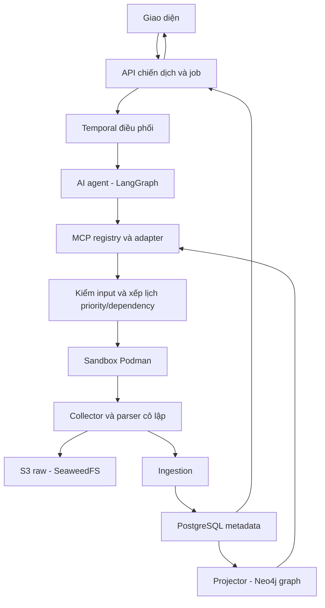

# AEGIS–Vanguard: nền tảng AI điều phối tool

> Nguồn thiết kế hiện hành. Quyết định D29 ngày 2026-11-16 theo chỉ đạo trực tiếp của chủ sản phẩm thay thế mô hình phân tầng/phân nhóm thao tác trước đây. [Quyết định và phạm vi](../s1/00-thanh-phan-va-quyet-dinh.md).

## 1. Mục tiêu

AI agent chọn tool, lập thứ tự chạy, đọc kết quả và tiếp tục khám phá tài sản trong campaign nội bộ trên tài sản tổ chức sở hữu hoặc được ủy quyền. Sản phẩm phục vụ pentest chủ động: xác định điểm yếu có thể kiểm chứng được và giữ bằng chứng. Nền tảng quản lý việc thực thi bền vững và dữ liệu; tool cung cấp năng lực quét, kiểm chứng động hoặc kiểm thử credential cụ thể. Theo quyết định 13/11, không dùng allowlist phạm vi: asset lần ra từ seed được quét tiếp, giữ quan hệ nguồn gốc về campaign; không thêm thủ tục xác minh/duyệt riêng từng asset. Điều kiện schema, nguồn gốc, ngân sách và mạng vẫn được kiểm trước dispatch.

Vòng lặp: mục tiêu → agent lập kế hoạch → gọi tool qua MCP → sandbox chạy → raw vào S3 → chuẩn hóa metadata/graph → agent đọc tri thức mới → lập việc tiếp theo.

Người dùng nội bộ gồm SOC/AppSec, SRE, kiến trúc sư bảo mật và kỹ sư nền tảng. Họ cần truy nguyên tài sản/finding, xác minh thay đổi qua các lần quét và thêm tool bằng adapter. UI phải cho thấy việc đã làm, việc còn chờ, lỗi và bằng chứng.

| Kịch bản | Kết quả cần đạt |
| --- | --- |
| Khám phá từ seed | Asset/service/endpoint có định danh thống nhất và đường nguồn gốc về seed/job |
| Phân tích artifact bằng tool đã tích hợp | Package, endpoint hoặc finding gắn digest/location và bằng chứng gốc |
| Đối chiếu tình báo lỗ hổng | Candidate gắn package/version và snapshot nguồn, có lý do khớp |
| Kiểm chứng động và credential | Tool có input rõ, kết quả thử đăng nhập/xác minh và đối chứng âm được lưu thành evidence; agent không cầm credential vận hành |
| Quét lại và theo dõi thay đổi | Giữ lịch sử; kết luận đã sửa cần coverage và bằng chứng mới |
| Tích hợp tool | Input/manifest/parser có conformance; thêm tool cùng runtime không sửa lõi |

Đầu vào API hiện hỗ trợ domain, IP/CIDR, URL, email và keyword. G3 giữ yêu cầu nhận repo, tài khoản cloud, cluster và artifact; phải khóa schema/reference tương ứng trước khi đưa vào API/registry. Các loại input/schema có thể triển khai lấy từ contract đã khóa; một tool xuất hiện trong catalogue chưa tạo ra endpoint hay loại seed mới.

## 2. Các thành phần chính

| Thành phần | Trách nhiệm | Công nghệ hiện chọn |
| --- | --- | --- |
| AI agent điều phối | Chọn tool, tham số, priority, dependency; suy luận và tổng hợp kết quả | LangGraph; ModelClient OpenAI/Anthropic với model cấu hình trực tiếp |
| Điều phối bền vững | Queue, timer, retry, pause/resume/cancel, ngân sách, checkpoint | Temporal |
| MCP | Khám phá tool và input schema; nhận lời gọi; truy vấn tri thức/bằng chứng có giới hạn | MCP server + registry + adapter |
| Sandbox thực thi | Chạy từng tool invocation, giới hạn tài nguyên, cách ly mạng/filesystem, thu kết quả | Podman rootless, ContainerRunner |
| CSDL metadata | Campaign, seed, job, dependency, trạng thái, cấu hình, audit, finding, tham chiếu raw | PostgreSQL |
| CSDL graph | Asset và quan hệ có provenance; bản chiếu dựng lại từ metadata | Neo4j |
| Kho raw | Output gốc, log, artifact, báo cáo và checksum | S3 qua EvidenceStore; SeaweedFS |
| Giao diện | Tạo chiến dịch, xem kế hoạch, job, lỗi, graph, finding và bằng chứng | React/TypeScript/Vite; React Flow với ELK hoặc dagre, Cytoscape.js; SSE |
| Ingestion/collector | Đưa raw vào S3, kiểm và chuẩn hóa kết quả vào kho tri thức | M06 collector, M27 ingestion, M23 projector |

Các công nghệ là lựa chọn triển khai có sẵn; không phải ràng buộc rằng mọi thành phần phải thành một microservice riêng. Mã Mxx dùng truy vết trách nhiệm, không định nghĩa thêm tầng sản phẩm.

## 3. Mô hình điều phối

Một job xác định: campaign, capability/tool, provider/version, input có kiểu, targets, priority, depends_on, ngân sách và người/agent đề xuất.

- Priority 0–100, số lớn chạy trước; mặc định 50. Job chưa đủ dependency không được chạy dù priority cao.
- depends_on chỉ tham chiếu job đã có trong cùng campaign. M05 kiểm tồn tại, self-reference, chu trình; dependency chỉ đạt khi SUCCEEDED. Job phụ thuộc thất bại/hủy vẫn chờ và hiện lý do trên UI; agent có thể tạo kế hoạch thay thế, không tự coi là thành công.
- Trong tập job sẵn sàng và đủ ngân sách: priority giảm dần, created_at tăng dần, job_id để phân xử cuối cùng. Tôn trọng giới hạn concurrency và rate.
- Retry gửi lại cùng yêu cầu không tạo job mới. Lần quét mới dùng scan_cycle mới. Priority/dependency bất biến sau khi nhận; điều chỉnh kế hoạch bằng cancel và job mới, có audit.
- M05 kiểm schema, tool đã đăng ký, điều kiện mục tiêu, nguồn gốc, ngân sách và khả năng sandbox. Không có trường phân loại tác động hoặc gói chế độ quét trong job.
- Không có workflow duyệt theo phân loại thao tác. Actor/provenance được ghi cho mọi job.

## 4. MCP và tool

Agent là MCP client. Registry công bố tool/capability và schema qua tools/list; agent gọi tools/call. Tool CLI chạy qua adapter trong sandbox, không cần sửa CLI thành MCP server. Model không phải MCP server. Lời gọi được chuẩn hóa ở biên agent–tool; không đặt thêm hệ thống phân cấp tác tử vào mô hình sản phẩm.

MCP là giao thức, không thay queue hay sandbox. Một lời gọi tool thực thi trả job_id ngay; kết quả được đọc qua query tool khi job xong. Truy vấn graph/evidence có schema và giới hạn, không cho agent SQL/Cypher tự do.

Tool lựa chọn bằng tên/capability + provider/version + input, không bằng gói tham số ẩn. Manifest có inputDefaults, input/output schema, image digest, quyền mạng cụ thể và giới hạn CPU/RAM/timeout. Input cuối sau ghép defaults phải kiểm lại bằng schema.

## 5. Dữ liệu và bằng chứng

PostgreSQL giữ metadata và lịch sử; Neo4j giữ bản chiếu quan hệ; S3 giữ raw bất biến theo SHA-256. Không nạp raw lớn vào prompt; agent nhận tóm tắt và reference, truy xuất đoạn trích có giới hạn khi cần.

Scanner ghi /out. Collector M06 tại mạng điều khiển kiểm file thường, không theo symlink, áp trần rồi tải lên S3. Parser cô lập không mạng/credential trả ResultEnvelope; M27 kiểm schema, provenance, hash và dedup rồi ghi metadata/outbox. M23 chiếu Neo4j sau commit.

Dữ liệu quét từ scanner/adapter luôn qua M27. Campaign/session/job do module sở hữu ghi metadata trực tiếp. Lịch sử bất biến, chỉ thêm; cột trạng thái hiện tại được cập nhật kèm lịch sử. Graph có thể rebuild; không dùng graph làm kho raw.

Finding có evidence/ref, SHA-256 và trạng thái rõ. Agent đánh giá severity kèm lý do; lỗi đánh giá có trạng thái chưa đánh giá thay vì tạo kết luận giả. Giá trị severity mô tả finding, không dùng phân nhóm quyền chạy tool.

## 6. Phạm vi giao hàng

MVP là một vòng chạy được trọn: tạo campaign → agent chọn tool → MCP → sandbox → metadata/S3/graph → UI và agent đọc kết quả. Có nhiều job với priority/dependency, retry/pause/resume/cancel, audit và evidence. DNSx/Subfinder là hai adapter đầu để chứng minh một vòng nền tảng; chuỗi network/web/artifact, xác minh động và kiểm thử credential được giao ở cổng G2 theo kế hoạch. Các năng lực này được biểu diễn bằng tool/input, không có phân tầng thao tác. Danh mục mở rộng không tạo thêm thành phần nền tảng.

Tiêu chí: không job trùng theo khóa idempotency; không mất provenance; không dispatch dependency chưa đạt; container không vào control/data network; mỗi finding xác nhận có evidence; agent dừng theo budget; soak 7 ngày/10.000 bước khi nghiệm thu MVP. Đây là yêu cầu, chưa có bằng chứng sản phẩm đạt.

Giữ single-tenant và private ingress/VPN. Lịch giao cần ước lượng lại theo backlog mới, chưa cam kết số tuần. Các tool chuyên biệt chỉ được giao khi có manifest, schema, parser và test tương ứng; việc xuất hiện trong danh mục không đồng nghĩa đã có adapter.

## 7. Cấu trúc dự kiến

`services/{orchestrator,agent,mcp-server,ingestion,knowledge,intel,reporting,api}`, `adapters/<module>/<tool>`, `web`, `deploy`, `observability`, `tests`. Trạng thái implementation và kiểm chứng chỉ ghi tại [PROGRESS](../../PROGRESS.md).
