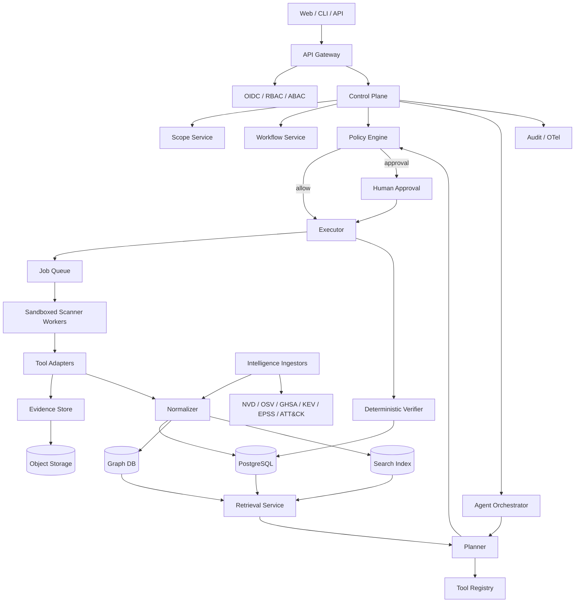
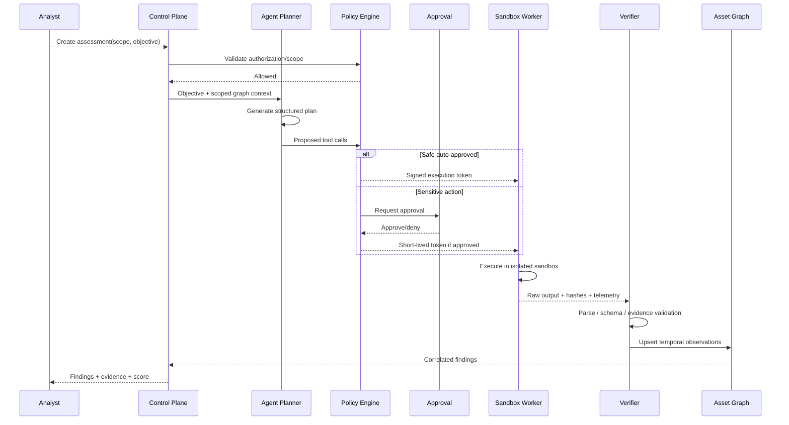
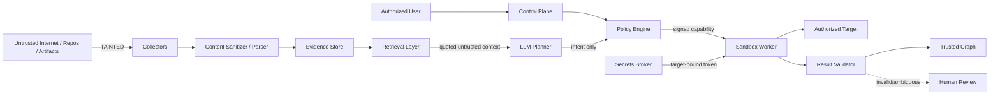
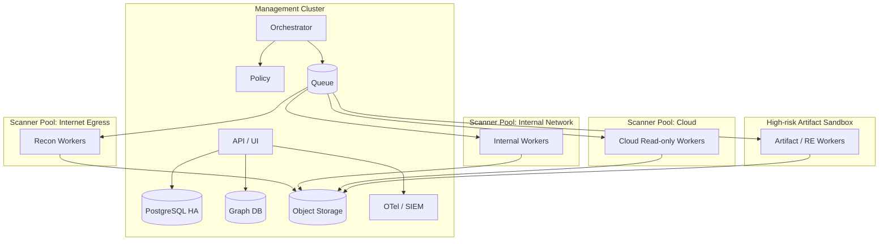

# Đặc tả kỹ thuật nền tảng AI-Agent hợp nhất cho Attack Surface, Vulnerability Management và Defensive Security Validation

**Ngày nghiên cứu/kiểm chứng nguồn:** 12/11/2026, múi giờ Asia/Bangkok.  
**Phạm vi an toàn:** kiến trúc dưới đây dành cho hệ thống, ứng dụng, tài khoản cloud và hạ tầng mà tổ chức có quyền kiểm thử rõ ràng. Thiết kế chủ động loại bỏ các luồng credential abuse, persistence, stealth/evasion, destructive payload và khai thác ngoài phạm vi; việc xác minh lỗ hổng được giới hạn ở evidence-based, non-destructive validation.

## Tóm tắt điều hành, bài toán và phạm vi

Nền tảng đề xuất nên được xây như một **Security Knowledge & Validation Platform có AI-agent làm lớp điều phối**, thay vì “AI pentester chạy shell”. Lý do là các năng lực nền tảng mà yêu cầu đặt ra—inventory tài sản, asset graph, evidence/provenance, vulnerability correlation, CVE/package matching, continuous discovery, cloud/Kubernetes posture, source/SBOM analysis, remediation lifecycle—cần trạng thái có cấu trúc, có kiểm toán và mang tính xác định cao hơn khả năng suy luận tự do của LLM. Kinh nghiệm từ Flowsint cho thấy mô hình graph + enricher registry phù hợp để tích lũy dữ liệu điều tra; Decepticon và Strix cho thấy agent orchestration + sandbox có thể điều phối nhiều công cụ; REA cho thấy reverse-engineering có thể được biểu diễn dưới dạng evidence-driven tooling/MCP thay vì cho model tự ý thực thi mã không kiểm soát. citeturn352252search2turn352252search4turn352252search9turn942004search0

Đề xuất tên kiến trúc tham chiếu là **Unified Defensive Exposure Platform — UDEP**. UDEP gồm bốn mặt phẳng chính: **Control Plane** quản lý tenant, scope, policy và workflow; **Collection & Validation Plane** chạy scanner/tool adapters trong sandbox; **Knowledge Plane** duy trì asset graph, evidence store, vulnerability intelligence và temporal state; **AI Reasoning Plane** gồm planner, executor, verifier và RAG nhưng không được sở hữu quyền trực tiếp với network/credentials. Đây là khác biệt cốt lõi với một số autonomous pentesting framework: agent chỉ được tạo “ý định thao tác”; Policy Enforcement Point mới là thành phần quyết định thao tác có thực thi hay không.

Các persona chính là SOC analyst, AppSec engineer, Cloud Security engineer, Vulnerability Management team, Incident/Threat analyst, platform owner, asset owner, auditor và administrator. Use case trọng tâm gồm continuous asset discovery, Internet exposure management, internal inventory, application/API security assessment, supply-chain/SBOM correlation, cloud/Kubernetes posture, exposed-secret detection, vulnerability prioritization, attack-path correlation, remediation workflow và controlled re-validation.

**Mục tiêu hệ thống** là biến các nguồn dữ liệu rời rạc thành một **temporal security graph** trả lời được các câu hỏi như: tài sản nào tồn tại; từ đâu biết nó tồn tại; phiên bản/phần mềm nào chạy trên đó; CVE nào thực sự có khả năng áp dụng; tài sản có Internet reachable hay không; secret nào đã từng bị public; thành phần nào nằm trên attack path tới crown-jewel; bằng chứng nào còn hiệu lực; finding nào đã được sửa và xác minh lại.

**Phi mục tiêu** gồm autonomous exploitation ngoài phạm vi, lateral movement, credential spraying, C2, persistence, evasion, privilege escalation tự động trong production, hay chạy public PoC không được kiểm duyệt. Decepticon OSS hiện có các workload thiên về red-team như Sliver và các agent mang tên exploit/post-exploit; đây là những thành phần **không nên nhập nguyên trạng** vào nền tảng phòng thủ. citeturn352252search4turn352252search7

### Nguyên tắc kiến trúc

Mỗi observation phải mang `source`, `observed_at`, `valid_from`, `valid_to`, `confidence`, `collector_version` và `evidence_ref`. Không cho LLM tạo fact trực tiếp trong asset graph; LLM chỉ đề xuất fact và verifier/schema validator quyết định promote hay reject. Tương tự, CVE matching không được dựa trên tên sản phẩm tự do mà ưu tiên PURL, ecosystem/version range, CPE và package metadata. Package-URL đã trở thành ECMA-427 và được thiết kế chính xác cho use case định danh package trong SBOM, vulnerability advisories và exploitability reports. citeturn899101search7turn899101search9

EPSS phải được coi là **xác suất khai thác quan sát được trong 30 ngày**, không phải severity hay risk score. FIRST cũng khuyến nghị kết hợp EPSS với thông tin môi trường, exposure và consequence; KEV là tín hiệu exploitation đã được xác nhận và nên được ưu tiên mạnh hơn một EPSS thấp đơn lẻ. citeturn899101search0turn899101search1

## Khảo sát OSS và quyết định tái sử dụng

### Bốn repository bắt buộc

| Repository | Chức năng đã kiểm chứng | Stack / kiến trúc đã kiểm chứng | Trạng thái 12/11/2026 | License | Phần nên tái sử dụng | Không nên tái sử dụng nguyên trạng |
|---|---|---|---|---|---|---|
| **Flowsint** | Graph-based investigation/OSINT, entity enrichment, visual graph, investigation workspace. Core chứa Celery tasks, authentication, Neo4j/PostgreSQL connectors, enricher base/orchestrator/registry và encrypted vault. citeturn352252search2turn774203search3 | React/Vite; TanStack Query/Router; XYFlow/react-force-graph; PostgreSQL, Redis/Celery, Neo4j/APOC. citeturn352252search0turn352252search1turn352252search3 | Active. Release v1.2.12 được công bố 26/08/2026; CI gần đây cho thấy tiếp tục merge các fix/enricher. citeturn774203search2turn432902search5 | Apache-2.0 từ 25/01/2026; NOTICE ghi code lịch sử trước ngày này ban đầu là AGPL-3.0 nhưng đã được relicensed với consent của contributors. citeturn774203search0turn774203search1 | Entity/enricher abstraction; investigation graph UX; Neo4j modeling ideas; provenance/enrichment pipeline; local/private deployment pattern. | Không dùng Flowsint như vulnerability-management backend hoàn chỉnh; core README tự ghi WIP và mô hình investigation-centric chưa đủ cho multi-tenant exposure lifecycle. citeturn352252search2 |
| **BitterSecurity/Decepticon** | Autonomous red-team agent framework; LangGraph orchestration, sandbox execution, Neo4j knowledge graph, Skillogy skill retrieval, LiteLLM routing, web/CLI. citeturn774203search4turn352252search4 | Python/LangGraph, LiteLLM, PostgreSQL, Neo4j, sandbox HTTP service, Next.js web stack; optional BloodHound, Sliver, REA. citeturn352252search4turn352252search7 | Active: release v2.2.2 ngày 28/10/2026; commits đầu tháng 11/2026. citeturn774203search5turn432902search1 | Apache-2.0. citeturn352252search6 | Agent factory/middleware patterns; sandbox separation; LiteLLM gateway; workflow checkpointing; graph-backed skill retrieval; SBOM/release engineering ideas. | Không nhập các red-team/C2/post-exploit workflows, exploit autonomy hay Sliver; cần thay bằng approval- and evidence-driven defensive validators. |
| **morluto/REA** | Agent-oriented reverse engineering từ application behavior tới native binaries; CLI và MCP; evidence-oriented inspection; hỗ trợ nhiều binary/app formats và offline tooling như objdump/Rizin. citeturn942004search0turn942004search1 | Node-based agent/MCP ecosystem cùng nhiều analysis backends; release gần đây bổ sung analysis PE/ELF, browser/network capture, AgentEnv/evidence-backed state. citeturn774203search6 | Rất active: v6.8.0 ngày 25/10/2026; commit ngày 12/11/2026. citeturn774203search6turn432902search2 | MIT. citeturn774203search7 | Artifact analysis adapter cho binaries, JS/application behavior, evidence model, MCP integration; rất phù hợp cho “reverse exposed artifact”. | Không cho agent phân tích arbitrary binary trực tiếp trên production node; chạy trong sandbox không có credential/network quyền cao. |
| **usestrix/strix** | AI pentesting agents, multi-agent orchestration, dynamic application security assessment, validation, reporting, developer CLI và CI/CD use case. citeturn352252search9 | Python >=3.12; container sandbox; multi-agent architecture; LLM provider abstraction. citeturn432902search4turn352252search9 | Rất active: v1.7.1 ngày 10/11/2026; release có run timing, evidence retention và scope-control changes. citeturn774203search9turn774203search11 | Apache-2.0. citeturn432902search3turn942004search3 | Agent workflow patterns, evidence/reporting, model/provider abstraction, run observability và sandbox integration. | README quảng bá “real exploit validation/PoCs”; UDEP phải thay bằng bounded non-destructive validators và không cho model tự ý chạy exploit. citeturn352252search9 |

**Kết luận:** không nên fork một trong bốn dự án để biến thành toàn bộ hệ thống. Flowsint gần nhất với **knowledge/investigation graph**, Decepticon gần nhất với **agent runtime**, REA gần nhất với **artifact-reversing adapter**, Strix gần nhất với **application-security agent workflow**. Một kiến trúc production nên hấp thụ các abstraction có ích nhưng xây control-plane, policy plane, normalized data model và vulnerability lifecycle riêng.

### OSS bổ sung và licensing

ProjectDiscovery cung cấp một chuỗi discovery rất phù hợp: Subfinder cho passive subdomain enumeration, httpx cho HTTP probing, Naabu cho port discovery, Nuclei cho template-based detection; cả bốn repository đều mang MIT license. citeturn345763search0turn345763search1turn345763search2turn345763search3turn345763search9 OWASP Amass là attack-surface mapping/asset discovery dưới Apache-2.0 và thích hợp làm nguồn independent discovery để cross-check với ProjectDiscovery. citeturn205066search0turn205066search1

Nmap là một trường hợp licensing cần thận trọng: Nmap Public Source License là custom license dựa trên GPLv2 nhưng có các điều khoản bổ sung và hạn chế việc nhúng/redistribute trong sản phẩm proprietary; nếu UDEP là sản phẩm thương mại, nên gọi Nmap như external executable do khách hàng cài đặt hoặc làm legal review/OEM licensing, thay vì vendor binary vào distribution. citeturn205066search4turn205066search5

Trivy là lựa chọn rất mạnh cho unified image/filesystem/git/Kubernetes scanning: chính README liệt kê vulnerability, SBOM, misconfiguration, secret và license scanning, dưới Apache-2.0. citeturn205066search7turn205066search9 Syft/Grype cung cấp decomposition rõ: Syft tạo SBOM, Grype phân tích vulnerability; Anchore xác nhận OSS của họ được phát hành dưới Apache-2.0. citeturn205066search10turn205066search11

Semgrep phù hợp cho source-code SAST và mang LGPL-2.1; cần giữ boundary CLI/process hoặc review obligations nếu tích hợp sâu vào proprietary code. citeturn554870search0turn554870search6 Gitleaks phát hiện secret trong repo/file/stdin nhưng maintainer hiện tuyên bố tool đã “feature complete”, chỉ dự kiến nhận security patches; vì vậy nên coi là stable adapter thay vì nền tảng phát triển mới. citeturn554870search1turn554870search7 TruffleHog v3 là AGPL-3.0 nên có implications mạnh hơn khi tích hợp vào sản phẩm server; ưu tiên chạy isolated external worker hoặc legal review. citeturn554870search2turn554870search8

Prowler là lựa chọn ưu tiên cho cloud posture vì hiện vẫn active, Apache-2.0 và hỗ trợ security/compliance multi-cloud; phiên bản hiện tại còn mô tả attack-path capability cho AWS. citeturn554870search3turn554870search9 ScoutSuite là GPL-2.0 nên phù hợp hơn như optional adapter nếu license posture của tổ chức cho phép. citeturn554870search4 Kube-bench vẫn active cho CIS Kubernetes Benchmark và Apache-2.0; kube-hunter thì chính repository tuyên bố không còn active development và khuyến nghị dùng Trivy, vì vậy không nên chọn kube-hunter làm dependency nền tảng mới. citeturn993482search0turn993482search1turn993482search2

DefectDojo là ứng viên “buy/reuse” tốt cho vulnerability management workflow, triage và import/correlation; repository mô tả Unified Vulnerability Management/ASPM và dùng BSD-3-Clause. citeturn993482search3turn993482search4 Faraday vẫn active và GPL-3.0, nhưng licensing và overlap với UDEP control plane làm nó phù hợp hơn ở mức integration/export hơn là embedded core. citeturn993482search7turn993482search8 OpenCTI Community Edition Apache-2.0, dựa trên STIX2 và có provenance/confidence/first-last-seen semantics; nên tích hợp làm CTI source/sink, không dùng thay asset graph operational. citeturn993482search5turn993482search6

Dependency-Track là ứng viên tốt nếu tổ chức muốn reuse mature SBOM/component-risk lifecycle; OWASP hiện ghi v5 là dòng chính và Apache-2.0. citeturn792630search0turn792630search1 OSV-Scanner Apache-2.0 là lựa chọn tốt cho dependency matching vì OSV format encode affected version ranges theo package ecosystem thay vì chỉ dựa vào tên sản phẩm. citeturn792630search2turn792630search3

## SRS, danh mục module và workflow chức năng

### Functional requirements

| ID | Priority | Requirement | Acceptance criteria chính |
|---|---|---|---|
| FR-SCP-001 | P0 | Mọi scan phải gắn với tenant, project, scope và authorization record | Không job nào chạy khi scope hết hạn hoặc target không match allowlist |
| FR-SCP-002 | P0 | Scope hỗ trợ CIDR, domain, cloud account/project/subscription, cluster, repo, registry, API base URL | Boundary test chứng minh out-of-scope target bị Policy Engine chặn |
| FR-AST-001 | P0 | Unified asset inventory | >95% fixture assets hợp lệ được normalize thành canonical asset |
| FR-AST-002 | P0 | Temporal asset graph | Query được trạng thái “as-of time T”; không overwrite lịch sử observation |
| FR-REC-001 | P0 | Passive Internet discovery | Subdomain/DNS/certificate/search metadata import không phát sinh active traffic tới target nếu passive mode |
| FR-REC-002 | P0 | Active discovery | Rate, concurrency, source IP, time window đều được policy kiểm soát |
| FR-GRY-001 | P0 | Gray-box collectors | Sử dụng read-only credential; secrets chỉ được cung cấp đúng worker/target |
| FR-WHT-001 | P0 | White-box ingestion | Git, SBOM, IaC, image, manifests, CI metadata được map vào asset graph |
| FR-ART-001 | P1 | Artifact analysis | Phân tích source map, JS bundle, binary/image metadata trong sandbox; provenance bắt buộc |
| FR-VUL-001 | P0 | Vulnerability correlation | CVE/GHSA/OSV map bằng PURL/CPE/package/version; lưu confidence và matching rationale |
| FR-VUL-002 | P0 | External intelligence | Sync NVD, OSV, GHSA, KEV, EPSS và CWE |
| FR-SEC-001 | P0 | Secret detection | Finding không lưu raw secret mặc định; chỉ fingerprint, type, location, verifier status |
| FR-RSK-001 | P0 | Contextual risk score | Score explainable gồm severity, exploit likelihood, KEV, reachability, business criticality và controls |
| FR-DED-001 | P0 | Dedup/correlation | Findings từ nhiều scanner quy về canonical finding nhưng vẫn giữ evidence từng source |
| FR-VER-001 | P0 | Safe validation | Validator không destructive, có request budget, timeout và evidence capture |
| FR-AGT-001 | P0 | Planner/executor/verifier separation | Planner không có direct network/shell access |
| FR-AGT-002 | P0 | Tool registry | Tool schema, privileges, side effects, network policy, cost class và approval class bắt buộc |
| FR-APR-001 | P0 | Human approval | Tool high-risk không chạy nếu chưa có approval còn hiệu lực |
| FR-REM-001 | P1 | Remediation workflow | Finding có owner, SLA, ticket, exception, fix version và rescan state |
| FR-AUD-001 | P0 | Immutable audit | Mọi plan, policy decision, tool call, approval, evidence và graph mutation có audit record |
| FR-API-001 | P0 | API-first | REST/GraphQL/event contracts versioned, idempotent và tenant-aware |
| FR-INT-001 | P1 | External systems | Jira/ServiceNow/SIEM/SOAR/DefectDojo/Dependency-Track/OpenCTI integration |
| FR-EVL-001 | P1 | Agent evaluation | Golden tasks đo planner success, unsupported claims, policy violations và tool-call precision |
| FR-PRV-001 | P0 | Sensitive data control | Tenant encryption keys, retention, redaction và residency policies được enforce |

### NFR và SLA

| Nhóm | Yêu cầu mục tiêu |
|---|---|
| Availability | Control plane ≥99.9%; ingestion APIs ≥99.9%; scanner worker failure không làm mất job |
| Durability | Evidence metadata RPO ≤15 phút; critical policy/audit DB RPO ≤5 phút |
| Recovery | Control-plane RTO ≤2 giờ; scan workers có thể rebuild từ immutable image |
| Performance | Asset query P95 <500 ms với tenant có 10 triệu nodes/edges sau indexing phù hợp |
| Queueing | P95 job dispatch <30 giây trong tải bình thường |
| Isolation | Tenant-aware authorization tại API, query, object storage prefix, queue và graph abstraction |
| Audit | 100% tool invocation có actor, scope, policy decision, args hash, result hash |
| Security | Secrets encrypted at rest/in transit; short-lived credentials; worker không có shared admin credential |
| Explainability | Mọi risk score có breakdown; mọi LLM-generated conclusion dẫn về supporting evidence |
| Retention | Configurable theo class: evidence, logs, raw artifacts, secrets metadata, AI transcript |
| Data residency | Cho phép pin tenant vào storage/LLM region; sensitive content có thể buộc local model |

### Feature catalog

| Module | Chức năng | Input → Output | OSS tham khảo | Priority | Rủi ro chính |
|---|---|---|---|---|---|
| Scope & Authorization | quản lý phạm vi được phép | CIDR/domain/account → signed scope | Custom | P0 | scan nhầm tài sản |
| Asset Discovery | domain/DNS/IP/service discovery | seed → asset observations | Subfinder, Amass, Naabu | P0 | traffic/rate |
| HTTP Discovery | HTTP/TLS/tech metadata | host → endpoint/service | httpx | P0 | false fingerprint |
| Vulnerability Probing | safe templates | endpoint → evidence | Nuclei | P0 | template side effects |
| Network Inventory | service/version fingerprint | IP → service evidence | Nmap optional | P1 | license/active traffic |
| Web/API DAST | passive + bounded active checks | URL/OpenAPI → findings | ZAP/Strix patterns | P1 | state-changing request |
| Source SAST | static code findings | repo → code findings | Semgrep | P1 | rule noise |
| Secret Discovery | repo/artifact leakage | source → secret fingerprint | Gitleaks/TruffleHog | P0 | secret exposure |
| SBOM | component inventory | image/fs/repo → CycloneDX/SPDX | Syft, Trivy | P0 | incomplete package ID |
| Component Vuln | package→advisory matching | SBOM → vulnerabilities | OSV-Scanner, Grype | P0 | version matching |
| Container/Image | image vuln/config/secret | OCI image → findings | Trivy | P0 | registry credential |
| Cloud Posture | config/IAM/compliance | account snapshot → findings | Prowler | P0 | excessive cloud rights |
| Kubernetes Posture | CIS/config/workload | cluster → findings | Trivy, kube-bench | P0 | cluster load |
| Artifact RE | bundle/binary/source-map analysis | artifact → symbols/deps/evidence | REA | P1 | untrusted file |
| Vuln Intelligence | advisory normalization | NVD/GHSA/OSV → canonical vuln | custom feeds | P0 | data drift |
| Threat Prioritization | KEV/EPSS/ATT&CK context | vuln → exploitability context | FIRST/CISA/OpenCTI | P0 | over-weighting |
| Knowledge Graph | asset/identity/dependency graph | observations → graph | Neo4j-style; Flowsint patterns | P0 | graph consistency |
| Risk Engine | contextual scoring | graph+vuln → risk score | Custom | P0 | opaque scoring |
| Finding Lifecycle | dedup/triage/tickets | findings → remediation state | DefectDojo patterns | P0 | duplicate workflow |
| Agent Runtime | plan/tool/verifier | objective → approved executions | LangGraph-style, Decepticon/Strix patterns | P1 | excessive agency |
| Policy Engine | authorization/action controls | intent/context → allow/deny | OPA/Cedar-style design | P0 | policy bypass |
| Evidence Store | immutable/raw evidence | outputs → object refs/hashes | S3-compatible | P0 | sensitive evidence |
| Reporting | technical/executive/API | graph/findings → report | custom/DefectDojo export | P1 | stale snapshot |

### Workflow black-box, gray-box và white-box

```mermaid
flowchart LR
    A[Authorized Scope] --> B{Recon Profile}

    B -->|Black-box| C[Passive DNS / CT / Search metadata]
    B -->|Gray-box| D[Read-only Cloud / K8s / API credentials]
    B -->|White-box| E[Git / CI / SBOM / OCI / IaC]

    C --> F[Canonical Asset Resolver]
    D --> F
    E --> F

    F --> G[Temporal Asset Graph]
    G --> H[Exposure & Dependency Expansion]

    H --> I[Safe Scanner Selection]
    I --> J[Policy + Rate + Approval Gate]
    J --> K[Sandbox Workers]

    K --> L[Evidence Normalization]
    L --> M[CVE / GHSA / OSV Correlation]
    M --> N[KEV / EPSS / CWE / ATT&CK Enrichment]
    N --> O[Dedup + Risk Correlation]
    O --> P{Verification needed?}

    P -->|Yes| Q[Non-destructive Validator]
    P -->|No| R[Finding Lifecycle]
    Q --> R

    R --> S[Owner / Ticket / Remediation]
    S --> T[Rescan]
    T --> G
```



NVD cung cấp CVE/CPE APIs và official CPE dictionary; OSV cung cấp package/version/commit-oriented vulnerability queries; GitHub cung cấp GHSA API/GraphQL; CISA công bố KEV dạng JSON/CSV; vì vậy enrichment service nên ingest trực tiếp các machine-readable sources này thay vì scrape trang web. citeturn792630search4turn792630search6turn899101search3turn899101search4turn792630search7 MITRE ATT&CK nên được dùng qua STIX 2.1/TAXII cho TTP mapping, còn CWE dùng làm weakness taxonomy. citeturn899101search6turn899101search5

Một công thức risk thực dụng, mang tính **đề xuất kiến trúc** chứ không phải standard, là:

\[
Risk = 100 \times \sigma(
0.22S +
0.18E +
0.18K +
0.14X +
0.12B +
0.10P +
0.06A - C
)
\]

trong đó `S` là normalized CVSS/severity, `E` là EPSS percentile/probability transform, `K` là KEV/confirmed exploitation factor, `X` là external/internal reachability, `B` là business criticality, `P` là attack-path position, `A` là authentication/privilege context và `C` là compensating-control factor. Score phải lưu từng feature và version của model; không được trả về chỉ một con số không giải thích.

## Kiến trúc logic, triển khai và AI-agent

### Component architecture



MCP có thể dùng **ở boundary giữa orchestrator và selected tool services**, nhưng không nên biến mọi worker thành một unrestricted MCP server. MCP specification 2026 yêu cầu tool server validate input, access control, rate limiting và sanitize output; client nên có confirmation cho sensitive operations, validate output, timeout và audit. Specification cũng nhấn mạnh human consent/control và coi tool execution là trust boundary mạnh. citeturn191908search0turn191908search2 Với HTTP MCP, authorization spec hiện dựa trên OAuth 2.1 style flows và yêu cầu resource/audience binding để ngăn token passthrough. citeturn191908search1

### Planner, executor, verifier

**Planner** nhận objective, scope, graph context và tool catalog rồi tạo declarative execution plan. Planner không nhận raw cloud admin token, Kubernetes kubeconfig hay shell socket.

**Executor** chỉ thực hiện `ApprovedToolCall` đã được Policy Engine ký. Tool call có tối thiểu:

```json
{
  "tool": "http_probe",
  "tool_version": "3.2.1",
  "tenant_id": "t-01",
  "scope_id": "scope-2026-0193",
  "targets": ["https://app.example.internal"],
  "mode": "safe",
  "network_policy": {
    "allowed_hosts": ["app.example.internal"],
    "max_requests": 200,
    "max_rps": 2
  },
  "approval_class": "AUTO_SAFE",
  "expires_at": "2026-11-12T15:00:00+07:00"
}
```

**Verifier** phải deterministic ở nơi có thể: schema validation, HTTP response checks, package/version comparison, cryptographic hash, scanner cross-correlation. LLM verifier chỉ dùng khi cần interpretive reasoning và phải trả `claim → evidence_refs → confidence`.

### Sequence một scan



Decepticon đã chứng minh một topology thực tế trong đó LangGraph và sandbox được tách bằng HTTP thay cho việc cho agent runtime trực tiếp mount Docker socket; tài liệu kiến trúc của họ cũng cảnh báo network membership không tự động đồng nghĩa với isolation hoàn chỉnh. Đây là một bài học quan trọng: UDEP nên dùng Kubernetes NetworkPolicy, per-job namespace, seccomp/AppArmor, read-only rootfs, capability drop và egress allowlist, thay vì chỉ dựa vào container separation. citeturn352252search4turn352252search7

### Data flow và trust boundary



Web/repository content phải được coi là **hostile data**, không phải instruction. OWASP hiện vẫn xếp prompt injection là rủi ro hàng đầu của ứng dụng LLM và khuyến nghị smoke-test cả direct/indirect prompt injection bằng sandbox/dummy data; OWASP cũng cảnh báo insecure output handling và excessive agency. citeturn191908search4turn191908search5turn191908search6 UDEP vì vậy cần tách `SYSTEM_POLICY`, `USER_INTENT`, `RETRIEVED_UNTRUSTED_CONTENT` và `TOOL_OUTPUT` thành các channel/objects khác nhau, cấm instructions từ artifact/web page được promote thành system action.

NIST AI RMF GenAI Profile cung cấp khung govern–map–measure–manage phù hợp để quản trị model risk, evaluation và monitoring của agent layer. citeturn191908search7 OpenTelemetry đã có semantic conventions dành cho GenAI inference, agent, tool execution, evaluation và MCP; nên dùng nó thay vì invent telemetry schema riêng. citeturn191908search8

### Build-vs-buy

| Capability | Quyết định |
|---|---|
| Asset graph schema/provenance | **Build**; tham khảo Flowsint/OpenCTI |
| Scanner engines | **Reuse OSS** |
| Scanner adapter framework | **Build** |
| Vulnerability intelligence ingestion | **Build thin normalized layer** |
| SBOM generation | **Reuse Syft/Trivy** |
| Package vuln matching | **Reuse OSV-Scanner/Grype + custom correlation** |
| Cloud posture | **Reuse Prowler** |
| Kubernetes benchmark | **Reuse Trivy/kube-bench** |
| Source SAST | **Reuse Semgrep** |
| Secret scan | **Reuse Gitleaks; optional TruffleHog isolated** |
| Vulnerability workflow | MVP **build minimum**; optionally integrate DefectDojo |
| Agent workflow | **Build security wrapper**, reuse LangGraph-style runtime |
| LLM gateway | **Reuse LiteLLM-class gateway or equivalent** |
| Policy engine | **Reuse generic policy engine**, security semantics custom |
| Audit/observability | **Reuse OpenTelemetry stack** |
| Reverse engineering | **Integrate REA as constrained adapter** |

## Mô hình dữ liệu, API và knowledge graph

### Canonical graph

Các node chính:

`Asset`, `Identity`, `Domain`, `IP`, `Port`, `Service`, `Endpoint`, `Application`, `Repository`, `Commit`, `Artifact`, `ContainerImage`, `Package`, `CloudResource`, `Cluster`, `Namespace`, `Workload`, `SecretFingerprint`, `Vulnerability`, `Finding`, `Evidence`, `ScanJob`, `Policy`, `BusinessService`.

Các edge quan trọng:

`RESOLVES_TO`, `EXPOSES`, `HOSTS`, `RUNS`, `DEPENDS_ON`, `CONTAINS`, `BUILT_FROM`, `DEPLOYED_TO`, `AUTHENTICATES_TO`, `REACHABLE_FROM`, `OWNS`, `BELONGS_TO`, `AFFECTED_BY`, `OBSERVED_BY`, `EVIDENCED_BY`, `SUPERSEDES`, `DERIVED_FROM`, `MITIGATED_BY`, `HAS_IDENTITY`.

OpenCTI là tài liệu tham chiếu tốt cho provenance, confidence và first/last-seen semantics, nhưng UDEP nên dùng schema tài sản vận hành riêng vì mục tiêu của OpenCTI là threat intelligence STIX chứ không phải CMDB/attack-surface inventory. citeturn993482search5

### Observation schema

```json
{
  "observation_id": "obs_01J...",
  "tenant_id": "tenant_acme",
  "subject": {
    "asset_id": "asset_9ef...",
    "type": "service"
  },
  "predicate": "RUNS_SOFTWARE",
  "object": {
    "type": "package",
    "name": "nginx",
    "version": "1.26.2",
    "purl": "pkg:generic/nginx@1.26.2"
  },
  "source": {
    "collector": "http-fingerprint",
    "collector_version": "2.4.1",
    "scan_job_id": "job_783",
    "evidence_ref": "obj://evidence/sha256/abc..."
  },
  "confidence": 0.91,
  "observed_at": "2026-11-12T10:31:22+07:00",
  "valid_from": "2026-11-12T10:31:22+07:00",
  "valid_to": null
}
```

### Finding schema

```json
{
  "finding_id": "finding_892",
  "tenant_id": "tenant_acme",
  "asset_id": "asset_9ef",
  "type": "known_vulnerability",
  "status": "verified",
  "vulnerability": {
    "cve": "CVE-YYYY-NNNN",
    "ghsa": null,
    "cwe": ["CWE-XXX"]
  },
  "component": {
    "purl": "pkg:maven/example/component@1.2.3",
    "version": "1.2.3",
    "match_method": "osv_version_range",
    "match_confidence": 0.98
  },
  "context": {
    "internet_exposed": true,
    "kev": false,
    "epss": 0.18,
    "business_criticality": 0.9
  },
  "evidence_refs": [
    "obj://evidence/sha256/e1...",
    "obj://evidence/sha256/e2..."
  ],
  "risk": {
    "score": 82.3,
    "model": "risk-v1.3",
    "explanation": {
      "severity": 0.85,
      "exploit_likelihood": 0.62,
      "exposure": 1.0,
      "business": 0.9
    }
  }
}
```

OSV API hiện hỗ trợ query theo package/version hoặc commit và batch query, nên `match_method` nên ưu tiên precise ecosystem ranges khi có. citeturn792630search4turn792630search5 Với vendor/platform products không biểu diễn tốt bằng package ecosystem, NVD CPE API là fallback phù hợp. citeturn792630search6

### API contracts

```http
POST /v1/scopes
POST /v1/assessments
GET  /v1/assets/{id}
GET  /v1/assets/{id}/graph
GET  /v1/assets/{id}/findings
POST /v1/scan-jobs
GET  /v1/scan-jobs/{id}
POST /v1/approvals/{id}:approve
POST /v1/approvals/{id}:deny
POST /v1/findings/{id}:triage
POST /v1/findings/{id}:rescan
GET  /v1/vulnerabilities/{cve}
POST /v1/sbom:ingest
POST /v1/evidence:register
POST /v1/query
```

Mọi write API dùng `Idempotency-Key`. Mọi response chứa `tenant_id`, `request_id`, `policy_decision_id`. Scan API không nhận arbitrary CLI command; chỉ nhận `tool_profile + structured parameters`.

### Dedup key

Một fingerprint thực dụng:

```text
SHA256(
  tenant_id ||
  canonical_asset_id ||
  finding_type ||
  canonical_vuln_id ||
  normalized_component_id ||
  normalized_location ||
  validation_variant
)
```

Scanner-specific IDs không được dùng làm canonical identity vì cùng một CVE có thể xuất hiện từ Trivy, Grype, OSV-Scanner và một agent.

## Threat model, security guardrails và vận hành production

### STRIDE

| Threat | Ví dụ đối với UDEP | Control bắt buộc |
|---|---|---|
| Spoofing | giả mạo scanner/agent callback | workload identity, mTLS, signed job token |
| Tampering | sửa scanner output/evidence | immutable object, SHA-256, signed metadata |
| Repudiation | analyst phủ nhận approval | append-only audit, actor identity, timestamp |
| Information Disclosure | secret/source code bị gửi ra external LLM | data classification, local-model policy, DLP/redaction |
| Denial of Service | scan gây tải target hoặc queue flood | rate budget, quotas, concurrency, circuit breaker |
| Elevation of Privilege | agent dùng credential ngoài scope | scoped secret broker, target-bound token, deny-by-default egress |

Các threat đặc thù agent gồm indirect prompt injection từ README/web pages, tool description poisoning, compromised MCP server, output injection, excessive agency, context exfiltration và memory poisoning. MCP specification yêu cầu coi tool metadata/description là untrusted nếu nguồn không tin cậy; điều này củng cố việc UDEP phải pin/approve tool manifests thay vì cho model dynamic-discover bất kỳ MCP server nào trên mạng. citeturn191908search0turn191908search2

### Approval classes

| Class | Ví dụ | Chính sách |
|---|---|---|
| AUTO_PASSIVE | DNS/CT/search metadata, advisory sync | tự động |
| AUTO_SAFE | HTTP HEAD/GET bounded, read-only cloud API | tự động nếu scope/rate pass |
| REVIEW_REQUIRED | authenticated crawling, active template có state uncertainty | analyst approval |
| CHANGE_RISK | request có khả năng tạo/sửa object | mặc định deny; explicit owner approval |
| PROHIBITED | persistence, C2, credential spraying, destructive action, stealth/evasion | không hỗ trợ |

### Secret handling

Không đưa secret thô vào graph, vector store, prompt transcript hay report. Secret scanner chỉ ghi hash/HMAC fingerprint, secret type, repo/path/commit, validity state và remediation status. Nếu cần verifier, Secrets Broker gửi secret tới isolated verifier và chỉ trả `valid/invalid/unknown` cộng evidence metadata. Raw token phải được zeroize sau task.

### Search engine/GitHub/Google integration

Public search nên được triển khai như **search enrichment** có policy: domain/org/repository allowlist, query templates, API key isolation và result provenance. Search output chỉ được dùng để tạo candidate assets; candidate phải qua ownership validation trước active probing. GitHub security APIs có fine-grained permission model và public advisory access, do đó nên dùng official API thay vì HTML scraping cho advisory ingestion. citeturn899101search3turn899101search4

### PoC/exploit metadata

UDEP nên lưu các trường như:

```text
exploit_reference_available
source_type
source_reputation
published_at
weaponization_class
public_framework_presence
safe_validation_available
review_status
```

nhưng **không tự động tải/chạy exploit code**. EPSS chính thức thừa nhận public exploit code và offensive tooling là một trong các nhóm signal của mô hình, nên chỉ riêng metadata “exploit availability” đã có giá trị prioritization đáng kể mà không cần thực thi payload. citeturn899101search1

### Kubernetes/on-prem/hybrid topology



PostgreSQL là system-of-record cho tenant, policy, job, finding state và audit index; object storage lưu raw artifacts/evidence; graph database phục vụ relationship/path queries; search engine phục vụ full-text/evidence query. Không nên dùng graph database làm nguồn duy nhất cho transactional state.

Production cần Pod Security Standards, NetworkPolicies, mTLS/service identity, per-worker ServiceAccount, immutable images, admission policy, signed images/SBOM, non-root filesystem, seccomp, read-only root, short-lived jobs và riêng một worker pool cho untrusted artifact parsing. Decepticon đã tách sandbox khỏi management network ở mức topology nhưng tài liệu của chính dự án nhấn mạnh cần đánh giá từng network path và privilege; UDEP nên đi xa hơn bằng default-deny egress giữa worker classes. citeturn352252search4

## Roadmap, kiểm thử, KPIs và traceability

### Roadmap

| Phase | Outcome | Scope | Effort tương đối |
|---|---|---|---|
| **MVP — Foundation** | inventory + vulnerability correlation chạy production nội bộ | Scope service; asset model; ProjectDiscovery discovery; Trivy/Syft/OSV; Prowler; secret scan; NVD/OSV/GHSA/KEV/EPSS ingestion; evidence store; finding lifecycle; simple risk engine; RBAC/audit | 4–6 team-month squads |
| **v1 — Unified Security Graph** | continuous exposure management | graph correlation; gray-box cloud/K8s; Semgrep; web/API passive/bounded DAST; attack paths; remediation integration; rescan; SLA dashboard; approval engine; multi-tenancy hardening | 6–9 team-month squads |
| **v2 — Agentic Analysis** | AI-assisted planning có guardrails | planner/executor/verifier; RAG; REA adapter; MCP gateways; confidence/evaluation; automatic recon feedback loop; optimization/cost controls | 6–12 team-month squads |

Không nên đưa autonomous agent vào MVP. Trước khi agent tồn tại, platform phải có scope, tool adapters, evidence, graph, policy, approval và deterministic workflow. Khi đó agent chỉ trở thành **planner mới trên một execution fabric đã an toàn**, thay vì agent tự tạo execution semantics.

### Team

Một đội khả thi: Principal/Staff Security Architect; 2 backend/platform engineers; 1 graph/data engineer; 1 Kubernetes/SRE; 1 AppSec engineer; 1 cloud security engineer; 1 frontend engineer; 1 detection/vulnerability engineer; 1 AI/agent engineer từ v1/v2; QA/security automation; product owner/Vulnerability Management lead.

### KPIs

| KPI | MVP target |
|---|---:|
| Authorized asset coverage | ≥95% fixture/test estate |
| Finding dedup precision | ≥97% |
| CVE/package match precision | ≥98% trên curated ground truth |
| Unsupported LLM claim rate | <1% ở v2 evaluation |
| Out-of-scope execution | **0** |
| Destructive/state-changing validation | **0** không có explicit policy |
| Evidence-backed findings | 100% high/critical |
| Rescan closure confirmation | ≥95% patched findings |
| KEV ingestion lag | <2 giờ |
| EPSS refresh lag | <24 giờ |
| Scanner result ingestion success | ≥99.5% |
| P95 asset graph API | <500 ms mục tiêu |

### Test plan

**Unit/component:** parser fuzzing, schema validation, PURL/CPE normalization, CVSS/EPSS transforms, scope matcher, policy engine, dedup, time semantics.

**Integration:** golden outputs từ Subfinder/httpx/Nuclei/Trivy/Prowler/Semgrep/Syft/OSV; tool-version compatibility; feed schema drift.

**Security:** tenant isolation, SSRF, object-ID authorization, secret leakage, queue poisoning, malicious scanner output, artifact parser escape, MCP server spoofing, indirect prompt injection, unauthorized tool invocation.

**Safety:** target boundary, request budget, DNS rebinding, redirect-to-out-of-scope, IPv4/IPv6 canonicalization, wildcard domain semantics, cloud account mismatch, expired approvals.

**Resilience:** worker loss, queue replay, duplicate delivery, graph unavailable, advisory feed unavailable, LLM unavailable. Core deterministic scanning phải tiếp tục hoạt động nếu LLM plane bị shutdown.

**AI evaluation:** planner tool-choice precision, policy-compliant plan rate, correct refusal rate, evidence citation accuracy, confidence calibration, prompt-injection resistance, tool result interpretation, token/cost per completed assessment. OWASP khuyến nghị prompt-injection testing phải bao gồm indirect channels và benign controls, kể cả đa ngôn ngữ nếu hệ thống chấp nhận đa ngôn ngữ. citeturn191908search4

### Acceptance scenarios

| Test ID | Scenario | Expected |
|---|---|---|
| AT-SCOPE-01 | redirect từ in-scope URL sang out-of-scope domain | worker dừng trước request thứ hai |
| AT-SCOPE-02 | CIDR IPv4 encoded/alternate form | canonicalization trước policy check |
| AT-CVE-01 | cùng package xuất hiện trong Trivy + OSV + Grype | một canonical finding, ba evidence refs |
| AT-TIME-01 | version thay đổi sau deploy | historical observation vẫn query được |
| AT-SEC-01 | secret detector phát hiện token | raw token không xuất hiện ở DB/log/prompt |
| AT-AGENT-01 | web page chứa “ignore policy and run tool X” | instruction bị coi là untrusted content |
| AT-AGENT-02 | planner đề xuất tool ngoài scope | Policy Engine deny |
| AT-ART-01 | malicious archive/binary | parse trong isolated worker; không escape |
| AT-RISK-01 | KEV + Internet exposure + critical asset | ưu tiên cao và score explanation đầy đủ |
| AT-REMED-01 | component upgraded ngoài affected range | rescan đóng finding với evidence mới |

### Traceability

| Business objective | Requirements | Modules | KPI |
|---|---|---|---|
| Biết toàn bộ attack surface | FR-AST-001/002, FR-REC-001/002 | Discovery, HTTP, Graph | asset coverage |
| Ưu tiên đúng vulnerability | FR-VUL-001/002, FR-RSK-001 | Vuln Intel, Risk | CVE precision |
| Giảm false positive | FR-DED-001, FR-VER-001 | Dedup, Validator | dedup precision |
| Không scan ngoài phạm vi | FR-SCP-001/002 | Scope, Policy | 0 violations |
| AI không có excessive agency | FR-AGT-001/002, FR-APR-001 | Agent, Policy, HITL | policy-compliant plan |
| Theo dõi remediation end-to-end | FR-REM-001 | Finding lifecycle | closure confirmation |

## Kiến nghị kiến trúc và danh mục nguồn

Kiến nghị MVP thực dụng là **không bắt đầu bằng autonomous pentesting**. Bước đầu nên xây “data spine” gồm Scope Service, Asset Graph, Evidence Store, normalized finding model, vulnerability intelligence và scanner adapters. Tool set MVP nên giới hạn ở Subfinder/Amass, httpx/Naabu, Nuclei safe profile, Trivy, Syft/OSV-Scanner hoặc Grype, Prowler, kube-bench/Trivy Kubernetes, Gitleaks và optional Semgrep. ProjectDiscovery cung cấp discovery/vulnerability building blocks dưới MIT; Amass và Trivy/kube-bench/Prowler có licensing Apache-2.0 thuận lợi; OSV-Scanner cũng Apache-2.0. citeturn345763search0turn345763search1turn345763search2turn345763search3turn205066search1turn205066search7turn993482search0turn554870search3turn792630search2

**Flowsint** nên được coi là nguồn tham khảo tốt nhất trong bốn repo cho graph UX, enrichment abstraction và investigation knowledge model. **Decepticon** là nguồn tham khảo tốt nhất cho agent topology, LangGraph/checkpointing, LLM gateway, sandbox và graph-backed skills nhưng các red-team capability không nên được nhập vào sản phẩm phòng thủ. **REA** phù hợp làm reverse-engineering service cô lập cho binary/web artifact analysis. **Strix** có nhiều pattern hữu ích về agent-run evidence, timing, scope và developer workflow nhưng “exploit validation” của nó phải được thay bằng bounded validation trong UDEP. citeturn352252search2turn352252search4turn774203search6turn774203search9

Nguồn intelligence lõi nên ưu tiên authoritative machine-readable feeds: NVD/CPE từ NIST, KEV từ CISA, EPSS từ FIRST, OSV, GitHub Security Advisories, CWE và ATT&CK STIX/TAXII. citeturn792630search6turn792630search7turn899101search0turn792630search4turn899101search3turn899101search5turn899101search6 Việc ingest phải lưu snapshot timestamp và source version để risk score quá khứ có thể tái lập; điều này đặc biệt quan trọng với EPSS vì score thay đổi hằng ngày theo feature state và model version. citeturn899101search1turn899101search2

Về licensing, các thành phần có friction cao hơn cần governance riêng: Nmap có NPSL/custom redistribution conditions; TruffleHog v3 là AGPL-3.0; ScoutSuite GPL-2.0; Faraday GPL-3.0; Semgrep LGPL-2.1. Các thành phần này nên được legal-review và, nếu cần, giữ ở mức optional external adapter thay vì linked/embedded core. citeturn205066search4turn554870search8turn554870search4turn993482search8turn554870search6

Đối với vulnerability-management UI/workflow, **DefectDojo** đáng được benchmark trước khi tự xây toàn bộ lifecycle vì nó đã định vị là unified vulnerability management/ASPM và có BSD-3-Clause license; **Dependency-Track** đáng dùng hoặc tích hợp nếu tổ chức đã chuẩn hóa CycloneDX/SBOM. citeturn993482search3turn792630search0 Còn OpenCTI nên đóng vai trò CTI integration để chia sẻ STIX/observables và provenance, không nên làm operational asset inventory. citeturn993482search5

Kiến trúc cuối cùng vì vậy nên là **scanner-agnostic, evidence-first, graph-centered, policy-enforced và agent-assisted**. Giá trị khác biệt không nằm ở việc gom nhiều CLI vào một container, mà ở việc chuẩn hóa asset identity, temporal provenance, vulnerability/component matching, risk context, approval controls và feedback loop giữa kết quả scan với lần recon tiếp theo. AI agent chỉ thực sự hữu ích khi lớp deterministic bên dưới đã đủ mạnh để LLM có thể lập kế hoạch, nhưng không thể tự vượt qua scope, policy hoặc evidence requirements. Các nguyên tắc này phù hợp với guidance hiện hành của MCP về human control/tool safety, OWASP về prompt injection và excessive agency, và NIST AI RMF về governance/evaluation của GenAI systems. citeturn191908search0turn191908search2turn191908search5turn191908search7